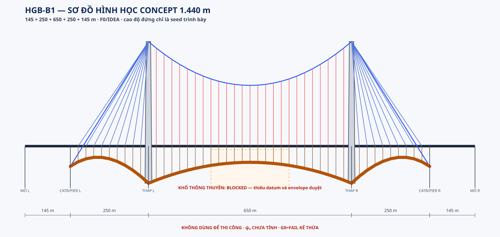
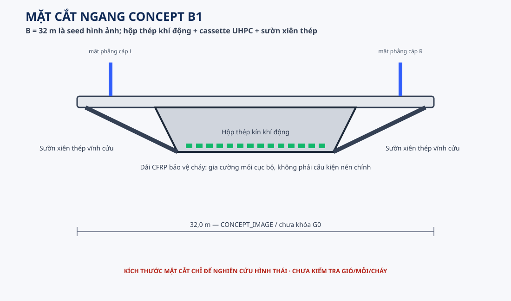

# HGB-B1 — Hình học concept canonical 1.440 m

## 0. Trạng thái và ranh giới sử dụng

| Mục | Trạng thái |
|---|---|
| Task | `RND-00fd963d-07` |
| Phương án người dùng chốt | **B1 — 1.440 m** |
| Chuỗi nhịp | **`145 + 250 + 650 + 250 + 145 = 1.440 m`** |
| Fidelity / claim | `F0 / IDEA` |
| `G0` | **`FAIL_INHERITED / STOP_FOR_ENGINEERING_CLAIMS`** |
| `G1` | `NOT_CLAIMED`; navigation và fabrication còn bị khóa |
| `G2` | `NOT_CLAIMED`; chưa có staged nonlinear solver |
| Phát hành kỹ thuật | **`PROHIBITED`** |

Kết quả vòng này là một bộ hình học concept tái lập để Codex và Claude cùng kiểm tra.
Nó không phải thiết kế cơ sở, thiết kế kỹ thuật hoặc hồ sơ thi công. Trục `x` đã có
đơn vị mét theo chuỗi nhịp người dùng khóa; trục `z` dùng datum cục bộ `z=0` tại mặt
cầu chỉ để dựng hình. Không được đọc bất kỳ `z_local_m` nào thành cao độ khảo sát.





## 1. Quyết định đã khóa và dữ liệu chưa khóa

### 1.1 `USER_CONFIRMED`

1. Biến thể `B1`: vòm giữa có interface truyền tải đứng với dầm.
2. Tổng chiều dài `1.440 m` và chain `145+250+650+250+145 m`.
3. Không có dây văng xiên phía trong hai tháp.
4. Giữ cáp chủ võng + hanger ở nhịp giữa; giữ quạt dây văng riêng ở phía đất liền.
5. Một vòm giữa liên tục nhập chân hai tháp và hai nửa vòm biên đối xứng.

### 1.2 `DERIVED_FROM_USER_CONFIRMED_TOPOLOGY_AND_CHAIN`

| Landmark | Station `x` | Vai trò F0 |
|---|---:|---|
| `AB-L` | `0 m` | mố trái |
| `CATB/PIER-L` | `145 m` | khối neo cáp + trụ chuyển tiếp + springing nửa vòm |
| `TN/SAD-L` | `395 m` | chân tháp / yên cáp trái; cùng station ở seed này |
| Mặt phẳng đối xứng | `720 m` | giữa nhịp chính |
| `TN/SAD-R` | `1.045 m` | chân tháp / yên cáp phải; cùng station ở seed này |
| `CATB/PIER-R` | `1.295 m` | khối neo cáp + trụ chuyển tiếp + springing nửa vòm |
| `AB-R` | `1.440 m` | mố phải |

`CATB` và trụ chuyển tiếp chỉ đang đồng vị trí trong graph concept. Khảo sát địa chất,
không gian buồng neo, tiếp cận kiểm tra và lực xô có thể buộc phải tách hai chức năng
ở vòng sau.

### 1.3 `RESEARCH_PLACEHOLDER_FOR_RENDER_ONLY`

Các giá trị sau chỉ giúp hình có tỷ lệ đọc được: `z_saddle=+155 m`,
`z_tower-foot=-55 m`, độ võng cáp `65 m`, đỉnh vòm giữa `z=-24 m`, chiều sâu hộp
`4,5 m`, bề rộng mặt cầu `32 m`, hai mặt phẳng cáp tại `y=±13 m`, bước panel chính
`25 m`. Chúng không có quyền lực thiết kế và phải bị thay bằng dữ liệu G0/G1.

## 2. Sơ đồ lực B1 được dựng

```text
CÁP CHỦ LIÊN TỤC:
  CATB-L -- backstay -- SAD-L -- main cable -- SAD-R -- backstay -- CATB-R
                             | hanger(*) |
                             v           v
                           DK-MAIN ===== DK-MAIN

DÂY VĂNG RIÊNG, CHỈ PHÍA BỜ:
  SAD-L -- ST-L(*) -- DK, với x_ST < 395 m
  SAD-R -- ST-R(*) -- DK, với x_ST > 1.045 m

VÒM B1:
  TN-L -- một vòm AC liên tục -- TN-R
                  | spandrel đứng(*) |
                  v                   v
                DK-MAIN =========== DK-MAIN

NỬA VÒM BIÊN:
  CATB-L -- AH-L(*) -- TN-L
  TN-R -- AH-R(*) -- CATB-R
```

Vai trò của từng hệ được giữ riêng trong graph, nhưng **phần tải đứng đi vào vòm
`ψ_a` không được gán bằng tay**. Nó vẫn là
`UNKNOWN_UNTIL_STAGED_NONLINEAR_SOLVER`. Hình có thanh đứng vòm–dầm chỉ chứng minh
interface B1 tồn tại, không chứng minh lực đã phân phối hợp lý.

## 3. Luật hình học sinh node

### 3.1 Cáp chủ nhịp 650 m

Với `u=(x-395)/650`, seed hình vẽ dùng:

```text
z_MS(u) = z_SAD - 4 f_c u(1-u)
z_SAD = +155 m; f_c = 65 m; 0 <= u <= 1
```

Đây là parabol hình học, không phải catenary cân bằng theo tĩnh tải.

### 3.2 Một vòm giữa liên tục

```text
z_AC(u) = z_TN + 4 (z_crown-z_TN) u(1-u)
z_TN = -55 m; z_crown = -24 m
```

Generator tạo đúng một spine `AC` từ `TN-L` đến `TN-R`; không có hai đầu vòm dừng
lơ lửng hoặc hai dầm va vào nhau. Hai nút springing được đóng trực tiếp vào node chân
tháp trong graph.

### 3.3 Hai nửa vòm biên

Mỗi nửa vòm dùng cubic Hermite từ `CATB` đến `TN`, sau đó mirror qua `x=720 m`.
Hai tiếp tuyến của seed được khai tường minh trong JSON, vì vậy không có cung tròn
hoặc đoạn cong ẩn. Các thanh spandrel đưa tải dầm biên xuống nửa vòm ở mức topology.

## 4. Mặt cắt dầm được giữ trong concept

- Dầm chính: hộp thép kín khí động; kích thước mới là seed hình thái.
- Mặt cầu: cassette thép–UHPC có thể thay thế để giảm thấm và xử lý mỏi cục bộ.
- Hai cánh hẫng: sườn xiên thép vĩnh cửu, không dùng xi-lanh thủy lực làm cấu kiện
  chịu lực chính.
- Giảm chấn thủy lực chỉ được phép đặt ở các nút chọn lọc sau phân tích động.
- CFRP có bảo vệ cháy chỉ làm dải gia cường mỏi hoặc panel nhẹ có thể thay; không
  thay thanh nén chính và không được gọi là vật liệu không cháy.

## 5. Kết quả kiểm độc lập

`hgb_b1_generate.py` sinh toàn bộ node/member từ JSON. `hgb_b1_verify.py` không import
hàm generator; nó đọc output, tính lại các luật và chạy một replay ở thư mục tạm.

| Kiểm | Kết quả |
|---|---|
| Tổng và closure chain | `SATISFIED_F0_GEOMETRY`, đúng `1.440,000000 m` |
| Đối xứng AB/CATB/TN/SAD | `SATISFIED_F0_GEOMETRY`, qua `x=720 m` |
| Cáp chủ theo luật | `27/27` node khớp độc lập |
| Đường cáp CATB–CATB | liên tục; terminal degree `1`, node trong degree `2` |
| Vòm giữa | `27/27` node khớp; endpoint tại hai `TN` |
| Hai nửa vòm | khớp luật Hermite; endpoint tại `CATB/TN` |
| Dây văng không vào nhịp giữa | `18/18` cạnh đạt điều kiện theo `x_SAD` |
| Endpoint graph | `252/252` member có node hợp lệ |
| Support–ground closure | 6 node `AB/CATB/TN` có cạnh riêng tới 6 terminal `GND` |
| CSV–JSON | `161/161` node khớp |
| Replay | JSON và CSV giống byte-for-byte |
| Khe local đáy hộp–tim vòm | `12,210000 m`, **render only** |
| Khổ thông thuyền | `BLOCKED_MISSING_INPUT` |
| Chia tải `ψ_a` | `NOT_RUN_SOLVER_REQUIRED` |
| Cân bằng dọc tháp | `NOT_RUN_SOLVER_REQUIRED` |
| Ổn định khí động | `NOT_RUN_WIND_STUDY_REQUIRED` |

Hash canonical tại vòng sinh:

- `b1_1440_geometry.json`: `0e501ec09b14c75b8952120b26141d818cc2096f9f8e951669a9e592257710f0`
- `b1_1440_nodes.csv`: `81d1b3a89f05e59e785b227614cc54416a0f5bbe1ce977b8243db63851a39061`

## 6. Phản biện kỹ thuật bắt buộc

### 6.1 Khổ thông thuyền là rủi ro loại phương án

Vòm nằm dưới dầm có thể cắt vào hộp khổ thông thuyền. Seed `250 x 60 m` đọc từ ảnh
không có datum và chưa được cơ quan có thẩm quyền khóa. Vì vậy hình tô vùng cảnh báo,
không tô vùng “đạt”. Nếu envelope được duyệt chiếm sát đáy dầm, B1 hiện tại chỉ có
bốn hướng xử lý: nâng trắc dọc cầu; nâng vòm gần đáy dầm; chừa một cửa không vòm ở
giữa luồng; hoặc loại vai trò vòm dưới nhịp chính. Không được lựa chọn bằng thẩm mỹ.

### 6.2 Cáp chủ và quạt dây văng ngoài có thể làm tháp mất cân bằng

Backstay của chính cáp chủ đã tạo thành phần lực về bờ. Quạt dây văng ngoài là hệ
riêng và tạo thêm lực về bờ. Không có dây văng trong để cân từng cặp, nên lực dọc và
mô men ở tháp phụ thuộc mạnh vào độ cứng dầm–vòm, pretension và giai đoạn thi công.
Không được tuyên bố “kéo xa dây ngoài là tự cân bằng”; bắt buộc có staged nonlinear
model và bài toán mất dây/tải lệch.

### 6.3 Một vòm giữa 650 m không được coi là vòm phụ nhẹ

Khi interface B1 truyền đứng, vòm tham gia hệ chính. Nút chân tháp/CATB, ổn định
ngoài mặt phẳng, buckling phi tuyến, lực xô móng và trình tự khép vòm trở thành vấn
đề chi phối. Vật liệu CFST–UHPC trong hình chỉ là hypothesis; chưa có kích thước,
grade, creep/shrinkage, thermal compatibility hoặc chi tiết joint.

## 7. Dữ liệu phải có trước vòng G1/G2

1. Bình đồ, trắc dọc, địa hình/địa chất và datum cao độ chính thức.
2. MNTK/MNCN đúng định nghĩa; rộng, cao và station của navigation prism đã duyệt.
3. Bề rộng cầu, số làn, tải trọng, gió cực trị, phổ nhiễu loạn và động đất.
4. Sơ đồ gối/khe co giãn; điều kiện biên dầm tại mố, CATB và tháp.
5. Material grades, hệ chống ăn mòn/cháy, tuổi thọ và chiến lược thay dây.
6. Solver staged nonlinear có cable sag, pretension, geometric nonlinearity,
   construction stages và eigen/buckling; sau đó mới đánh giá `ψ_a`.
7. Sectional model + CFD/wind tunnel cho flutter, vortex shedding và galloping cáp.

## 8. Tái lập

```text
python research/orchestration/RND-20260901-00fd963d/tools/hgb_b1_generate.py
python research/orchestration/RND-20260901-00fd963d/tools/hgb_b1_verify.py
```

Output canonical gồm JSON seed, JSON geometry, CSV node, JSON checks, mặt đứng SVG và
mặt cắt SVG. Bất kỳ thay đổi seed nào phải sinh lại toàn bộ; không sửa bảng node hoặc
đường SVG bằng tay.

## 9. Claim được phép

**Được phép:** “B1 1.440 m đã được khóa thành hình học concept F0 tái lập; các kiểm
closure, symmetry, node-law, no-inward-stay và replay đã đạt ở cấp hình học.”

**Bị cấm:** “đã cân bằng”, “đã đủ tĩnh không”, “đã chịu được tải”, “ổn định gió”,
“thi công được”, “an toàn”, “tối ưu”, “công nghệ chưa từng có” hoặc mọi nhãn
`SCREENED` trở lên.
